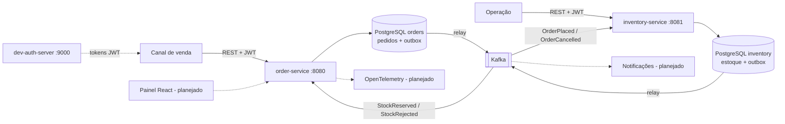

# OrderFlow Platform

Plataforma de pedidos e reserva de estoque para varejistas que vendem em mais de um canal. O problema é vender a mesma unidade duas vezes, reservar estoque em duplicidade quando um canal repete a requisição e deixar pedidos presos quando uma integração falha no meio do caminho. O repositório entrega dois serviços Spring Boot (pedidos e estoque), cada um com seu próprio PostgreSQL, que se comunicam por eventos versionados no Kafka usando transactional outbox, consumidores idempotentes, retry com backoff e dead-letter topic, atrás de uma API REST protegida por OAuth 2.0 com JWT e escopos.

[](https://github.com/asmeduardo/orderflow-platform/actions/workflows/ci.yml)
[](https://github.com/asmeduardo/orderflow-platform/actions/workflows/codeql.yml)
[](LICENSE)


> **Estado:** fases 1 (fundação), 2 (segurança e qualidade) e 3 (eventos) concluídas. Observabilidade, containers, Kubernetes, AWS e o painel React estão planejados para as fases 4 e 5.

## Destaques técnicos

- **Reserva de estoque sem venda dupla:** as linhas de produto são bloqueadas em ordem de SKU (`SELECT ... FOR UPDATE`) antes da verificação, e uma constraint `CHECK` garante no banco que o reservado nunca passa do estoque físico. Os testes mostram 40 compradores simultâneos disputando 10 unidades (exatamente 10 reservas) e a ausência de deadlock com itens em ordem invertida.
- **Idempotency key:** `POST /api/v1/orders` exige `Idempotency-Key`, isolada por cliente (`sub` do token). Repetir a requisição devolve o mesmo pedido com `Idempotent-Replayed: true`; reutilizar a chave com outro payload responde `422`. Doze requisições simultâneas com a mesma chave criam um único pedido.
- **Transactional outbox + Kafka:** o pedido e o evento são gravados na mesma transação (JSONB); um relay publica em ordem com `FOR UPDATE SKIP LOCKED` e só marca o evento como publicado após o acknowledgement. Com o Kafka pausado, a API continua aceitando pedidos e os eventos saem quando o broker volta.
- **Consumidores idempotentes e tolerantes a reordenação:** cada evento é registrado em `processed_event` na mesma transação dos seus efeitos; uma entrega duplicada não reserva duas vezes, e um `OrderPlaced` que chega depois do cancelamento não reserva nada.
- **Retry e DLT:** três retentativas com backoff exponencial, bloqueantes para preservar a ordem por pedido; mensagens irrecuperáveis (JSON inválido, versão de evento não suportada, falha persistente) vão para `<tópico>.DLT` com o motivo nos cabeçalhos.
- **Contratos de evento versionados:** envelope com tipo e versão, um record por versão e arquivos JSON de referência protegidos por testes de contrato.
- **OAuth 2.0 / JWT com escopos:** resource server que valida assinatura, emissor, audiência e expiração; `orderflow.read` para consultas e `orderflow.operate` para alterações; `401` e `403` em `ProblemDetail` (RFC 9457).
- **Testes com infraestrutura real:** PostgreSQL e Kafka via Testcontainers, ArchUnit para as dependências entre camadas e CI no GitHub Actions com CodeQL e Dependabot.
- **Evolução incremental:** o histórico de commits mostra o caminho do monólito modular até a extração do serviço de estoque com banco próprio ([ADR 0001](docs/adr/0001-evolucao-incremental.md)).

## Arquitetura



O pedido nasce `PENDING`; o estoque reserva tudo ou nada e responde por evento; o pedido passa a `CONFIRMED` ou `REJECTED`. Cancelar publica `OrderCancelled`, e o estoque libera a reserva. Os detalhes, incluindo o diagrama de sequência, estão em [docs/architecture.md](docs/architecture.md). As linhas tracejadas são partes planejadas.

## Stack

Somente o que está implementado:

| Área | Tecnologias |
| --- | --- |
| Linguagem e framework | Java 25 (LTS), Spring Boot 4.1 |
| API | Spring MVC, Bean Validation, `ProblemDetail` (RFC 9457), OpenAPI 3 e Swagger UI (springdoc-openapi) |
| Persistência | PostgreSQL 18, Spring Data JPA, Hibernate 7, Flyway (migrações SQL) |
| Mensageria | Apache Kafka 4.2 (KRaft), Spring Kafka |
| Segurança | Spring Security (resource server OAuth 2.0 com JWT), Spring Authorization Server (somente desenvolvimento) |
| Testes | JUnit 6 (Jupiter), Mockito, AssertJ, Testcontainers, Awaitility, ArchUnit |
| Build e qualidade | Maven (wrapper), Spotless, GitHub Actions, CodeQL, Dependabot |
| Ambiente local | Docker Compose |

Planejado (fases 4 e 5): containers dos serviços, Kubernetes e Helm, Terraform, AWS (EKS, ECR, RDS e CloudWatch), OpenTelemetry, Prometheus e Grafana, painel React com TypeScript e WireMock para integrações HTTP externas.

## Como executar

Pré-requisitos: JDK 25 e Docker.

```bash
cp .env.example .env    # defina as senhas dos bancos e os segredos dos clientes
docker compose up -d    # PostgreSQL de pedidos (5432), PostgreSQL de estoque (5433) e Kafka (9092)
./mvnw -DskipTests package
```

Em três terminais, a partir da raiz do repositório (os serviços leem o mesmo `.env`):

```bash
java -jar dev-auth-server/target/dev-auth-server-0.1.0-SNAPSHOT.jar      # http://localhost:9000
java -jar order-service/target/order-service-0.1.0-SNAPSHOT.jar          # http://localhost:8080
java -jar inventory-service/target/inventory-service-0.1.0-SNAPSHOT.jar  # http://localhost:8081
```

As migrações Flyway rodam na inicialização. Se alguma porta estiver ocupada, ajuste `POSTGRES_PORT`, `INVENTORY_POSTGRES_PORT` ou `KAFKA_PORT` no `.env`.

### Como obter um token

O servidor de autorização local tem dois clientes `client_credentials`: `orderflow-reader` (escopo `orderflow.read`) e `orderflow-operator` (escopos `orderflow.read` e `orderflow.operate`). Os segredos são os definidos no `.env`.

```bash
curl -s -u "orderflow-operator:$ORDERFLOW_OPERATOR_CLIENT_SECRET" \
  -d grant_type=client_credentials \
  -d "scope=orderflow.read orderflow.operate" \
  http://localhost:9000/oauth2/token
```

O `access_token` vale por 15 minutos e é enviado como `Authorization: Bearer <token>`. No Swagger UI, use o botão **Authorize** e cole o token.

- Swagger UI de pedidos: <http://localhost:8080/swagger-ui/index.html>
- Swagger UI de estoque: <http://localhost:8081/swagger-ui/index.html>
- Exemplos de requisições: [`http/orderflow.http`](http/orderflow.http), para o IntelliJ HTTP Client ou a extensão REST Client do VS Code. A sequência cadastra produtos, cria um pedido que é confirmado, repete a requisição com a mesma chave, cria um pedido rejeitado por falta de estoque e cancela um pedido.

## Testes

```bash
./mvnw verify
```

É o mesmo comando do CI e exige o Docker em execução. Ele verifica a formatação (Spotless) e roda 41 testes unitários e 76 de integração:

| Camada | O que comprova | Quantidade |
| --- | --- | --- |
| Unitários de domínio | regras de `Order`, `Money` (escala da moeda, sem `double`), `Product` e impressão digital da requisição | 24 |
| Unitários com Mockito | fluxo de idempotência do `OrderService`: replay, chave reutilizada e corrida entre requisições | 4 |
| Slice MVC | validação e formato dos erros sem subir o banco | 2 |
| Contratos de evento | JSON publicado igual ao de referência e leitura tolerante a campos novos | 5 |
| Arquitetura (ArchUnit) | dependências entre `domain`, `application`, `web` e `messaging` em cada serviço | 6 (3 regras por serviço) |
| Integração (Testcontainers) | API, PostgreSQL, Kafka, concorrência, idempotência, outbox com broker pausado, duplicidade, reordenação, retry e DLT, autorização com JWT real | 76 |

Os testes de autorização não usam um provedor de identidade: tokens são assinados com uma chave RSA gerada durante o teste, cuja parte pública é servida como JWKS localmente. Cada serviço é testado isoladamente, publicando os eventos do outro lado exatamente como os contratos definem. Para corrigir a formatação, use `./mvnw spotless:apply`.

## Estrutura do projeto

```text
.
├── event-contracts/       contratos de evento versionados (records e JSON de referência)
├── service-support/       infraestrutura comum: erros RFC 9457, segurança, OpenAPI, outbox, relay, deduplicação, retry e DLT
├── service-test-support/  fixtures de teste: Testcontainers, chaves JWT de teste e utilitários de Kafka
├── order-service/         API de pedidos (:8080), schema orders, histórico Flyway desde a fase 1
├── inventory-service/     API de produtos e estoque (:8081), schema inventory em banco próprio
├── dev-auth-server/       servidor de autorização OAuth 2.0 para desenvolvimento (:9000)
├── http/                  exemplos de requisições
├── docs/                  arquitetura, roadmap e ADRs
└── compose.yaml           PostgreSQL de cada serviço e Kafka para o ambiente local
```

Dentro de cada serviço, `domain` concentra entidades e regras, `application` os casos de uso e transações, e `web` e `messaging` os adaptadores HTTP e Kafka.

## Decisões

- [ADR 0001](docs/adr/0001-evolucao-incremental.md): começar como monólito modular e extrair o estoque depois.
- [ADR 0002](docs/adr/0002-stack-base.md): Java 25, Spring Boot 4.1 e Maven.
- [ADR 0003](docs/adr/0003-monolito-modular-com-schema-por-modulo.md): um schema por módulo, sem chaves estrangeiras entre contextos.
- [ADR 0004](docs/adr/0004-reserva-de-estoque-concorrente.md): reserva com bloqueio em ordem fixa e constraints no banco.
- [ADR 0005](docs/adr/0005-idempotencia-na-criacao-de-pedidos.md): chave de idempotência na criação de pedidos.
- [ADR 0006](docs/adr/0006-seguranca-oauth2-resource-server.md): resource server OAuth 2.0 com escopos e servidor de autorização local.
- [ADR 0007](docs/adr/0007-transactional-outbox.md): transactional outbox com relay ordenado.
- [ADR 0008](docs/adr/0008-eventos-versionados-e-consumidores-idempotentes.md): eventos versionados, consumidores idempotentes, retry e DLT.
- [ADR 0009](docs/adr/0009-extracao-do-servico-de-estoque.md): extração do estoque para um serviço com banco próprio, com procedimento de corte.

## Roadmap

| Fase | Conteúdo | Situação |
| --- | --- | --- |
| 1. Fundação | monólito modular, PostgreSQL, Flyway, API REST, testes e OpenAPI | concluída |
| 2. Segurança e qualidade | OAuth 2.0/JWT, escopos, testes de autorização e de arquitetura, CI e análise estática | concluída |
| 3. Eventos | Kafka, outbox, contratos versionados, idempotência, retry e DLT, extração do estoque | concluída |
| 4. Operação | métricas, logs e traces, painéis, containers, Kubernetes com `kind` e testes de fumaça | planejada |
| 5. AWS e demonstração | Terraform, ECR, EKS, RDS e CloudWatch; painel React para consultar pedidos, eventos e tentativas | planejada |

Também estão planejados a trilha de auditoria das mudanças de estado e o worker de notificações. O detalhamento por item está em [docs/roadmap.md](docs/roadmap.md). Para contribuir, veja [CONTRIBUTING.md](CONTRIBUTING.md); para relatar vulnerabilidades, [SECURITY.md](SECURITY.md).

## Licença

Distribuído sob a licença MIT. Consulte [LICENSE](LICENSE).
