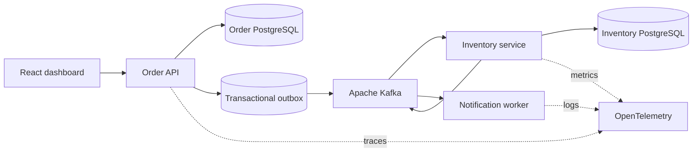

# OrderFlow Platform

[](https://github.com/asmeduardo/orderflow-platform/actions/workflows/ci.yml)
[](https://github.com/asmeduardo/orderflow-platform/actions/workflows/codeql.yml)

Plataforma de pedidos e reserva de estoque para pequenos varejistas que vendem em mais de um canal e precisam evitar venda sem estoque, reservas duplicadas e pedidos presos após falhas de integração.

> **Estado:** fases 1 (fundação) e 2 (segurança e qualidade) entregues: monólito modular com pedidos e estoque, PostgreSQL, API REST documentada e protegida por OAuth 2.0/JWT com escopos, testes de unidade, integração e arquitetura, e CI com análise de código e de dependências. Eventos com Kafka (fase 3) são a próxima entrega; o restante do documento indica o que ainda está planejado.

## Problema

Uma loja que recebe pedidos pelo site e por canais externos pode vender a última unidade duas vezes quando a atualização de estoque atrasa. A confirmação também pode falhar no meio do processo, deixando o cliente sem resposta e o estoque reservado indevidamente.

O projeto implementará esse fluxo com processamento assíncrono, idempotência, rastreabilidade e recuperação de falhas. O painel React permitirá que a operação encontre pedidos presos e acompanhe retentativas sem consultar diretamente o banco. Cada tecnologia deverá resolver um problema documentado; o repositório não será uma coleção de ferramentas sem função no domínio.

## Usuários e resultado esperado

- **Operação da loja:** visualiza o estado de cada pedido e recupera exceções com segurança.
- **Atendimento:** explica ao cliente se o pedido está confirmado, aguardando estoque ou cancelado.
- **Equipe técnica:** identifica falhas por logs, métricas e traces correlacionados.
- **Negócio:** reduz vendas sem estoque e mantém evidência de cada mudança de estado.

## Escopo funcional

- criar e consultar pedidos;
- reservar e liberar estoque;
- acompanhar a evolução do pedido;
- publicar e consumir eventos de domínio;
- impedir processamento duplicado;
- encaminhar mensagens irrecuperáveis para uma dead-letter queue;
- consultar o histórico de eventos e tentativas;
- exibir o estado operacional em um painel React enxuto.

## Arquitetura planejada



O diagrama mostra o destino. Hoje, pedidos e estoque rodam em um único processo, com um schema PostgreSQL por módulo e reserva síncrona na mesma transação; a [arquitetura](docs/architecture.md) descreve o estado atual e o [roadmap](docs/roadmap.md), os próximos passos.

## Stack

Em uso:

- Java 25 (LTS) e Spring Boot 4.1 ([ADR 0002](docs/adr/0002-stack-base.md));
- Spring MVC, Spring Data JPA/Hibernate e Bean Validation;
- PostgreSQL 18 e Flyway com migrações SQL versionadas;
- OpenAPI 3 e Swagger UI (springdoc-openapi);
- Spring Security como resource server OAuth 2.0 com JWT e, em desenvolvimento, Spring Authorization Server ([ADR 0006](docs/adr/0006-seguranca-oauth2-resource-server.md));
- JUnit 6 (Jupiter), Mockito, AssertJ, Testcontainers e ArchUnit;
- Maven (wrapper), Spotless e Docker Compose para o ambiente local;
- GitHub Actions (build e testes), CodeQL, dependency review e Dependabot.

Planejada:

- Apache Kafka (fase 3);
- WireMock para integrações HTTP externas;
- Kubernetes e Helm para orquestração;
- Terraform para infraestrutura reproduzível na AWS;
- Amazon EKS, ECR, RDS e CloudWatch;
- OpenTelemetry, Prometheus e Grafana;
- React e TypeScript no painel operacional.

## Critérios de qualidade

- nenhuma credencial no repositório;
- migrações versionadas;
- contratos HTTP documentados com OpenAPI e Swagger UI;
- testes unitários, de integração e de arquitetura;
- cobertura das regras críticas, sem meta usada como substituto de qualidade;
- imagens de container sem execução como `root`;
- análise estática e verificação de dependências no CI;
- health checks, métricas, logs estruturados e rastreamento distribuído;
- decisões relevantes registradas como ADRs;
- evidência de falhas testadas, inclusive duplicidade, indisponibilidade e repetição de mensagens.

## Execução local

Pré-requisitos: JDK 25 e Docker.

```bash
cp .env.example .env                        # defina as senhas e os segredos dos clientes
docker compose up -d                        # PostgreSQL 18
./mvnw -pl dev-auth-server spring-boot:run  # servidor de autorização local em http://localhost:9000
./mvnw -pl orderflow-app spring-boot:run    # API em http://localhost:8080 (em outro terminal)
```

Os serviços leem o mesmo `.env` (ignorado pelo Git) que o Docker Compose; as migrações Flyway rodam na inicialização. Se a porta 5432 estiver ocupada, ajuste `POSTGRES_PORT`.

### Como obter um token

O servidor de autorização local tem dois clientes `client_credentials`: `orderflow-reader` (escopo `orderflow.read`) e `orderflow-operator` (escopos `orderflow.read` e `orderflow.operate`). Os segredos são os definidos no `.env`.

```bash
curl -s -u "orderflow-operator:$ORDERFLOW_OPERATOR_CLIENT_SECRET"   -d grant_type=client_credentials -d "scope=orderflow.read orderflow.operate"   http://localhost:9000/oauth2/token
```

O campo `access_token` da resposta vale por 15 minutos e é enviado como `Authorization: Bearer <token>`. No Swagger UI, use o botão **Authorize** e cole o token.

- Swagger UI: <http://localhost:8080/swagger-ui/index.html>
- Contrato OpenAPI: <http://localhost:8080/v3/api-docs>
- Exemplos de requisições: [`http/orderflow.http`](http/orderflow.http) (IntelliJ HTTP Client ou extensão REST Client do VS Code)

### Testes

```bash
./mvnw verify
```

É o gate local e o mesmo comando do CI: verifica a formatação (Spotless), executa os testes unitários e de arquitetura (`*Test`, Surefire) e os de integração (`*IT`, Failsafe). Os testes de integração sobem um PostgreSQL real com Testcontainers e, por isso, exigem o Docker em execução. Entre eles estão os testes de concorrência da reserva de estoque e da chave de idempotência e os de autorização, que usam tokens assinados por uma chave gerada no próprio teste, sem provedor de identidade. Para corrigir a formatação, use `./mvnw spotless:apply`.

## Roadmap

O desenvolvimento será incremental. Cada fase deverá terminar com código executável, testes e documentação atualizada:

1. domínio de pedidos e estoque em um monólito modular (entregue);
2. persistência PostgreSQL, migrações e API REST (entregue);
3. autenticação, autorização e auditoria (autenticação e autorização entregues; auditoria planejada);
4. extração do processamento assíncrono com Kafka e outbox;
5. idempotência, retry, DLQ e testes de falha;
6. observabilidade;
7. containers e Kubernetes local;
8. infraestrutura AWS com Terraform;
9. painel React e demonstração publicada.

O painel React será a demonstração principal do fluxo de negócio. Swagger UI continuará disponível para que recrutadores e avaliadores possam inspecionar e experimentar os contratos do backend sem depender da interface web.

## Documentação

- [Arquitetura](docs/architecture.md)
- [Roadmap](docs/roadmap.md)
- [ADR 0001 — evolução incremental da arquitetura](docs/adr/0001-evolucao-incremental.md)
- [ADR 0002 — Java 25, Spring Boot 4.1 e Maven](docs/adr/0002-stack-base.md)
- [ADR 0003 — módulos com API pública e schema próprio](docs/adr/0003-monolito-modular-com-schema-por-modulo.md)
- [ADR 0004 — reserva de estoque concorrente](docs/adr/0004-reserva-de-estoque-concorrente.md)
- [ADR 0005 — idempotência na criação de pedidos](docs/adr/0005-idempotencia-na-criacao-de-pedidos.md)
- [ADR 0006 — resource server OAuth 2.0 com escopos](docs/adr/0006-seguranca-oauth2-resource-server.md)
- [Como contribuir](CONTRIBUTING.md)
- [Política de segurança](SECURITY.md)

## Licença

Distribuído sob a licença MIT. Consulte [LICENSE](LICENSE).
