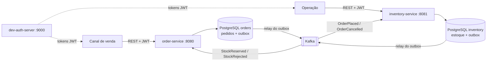
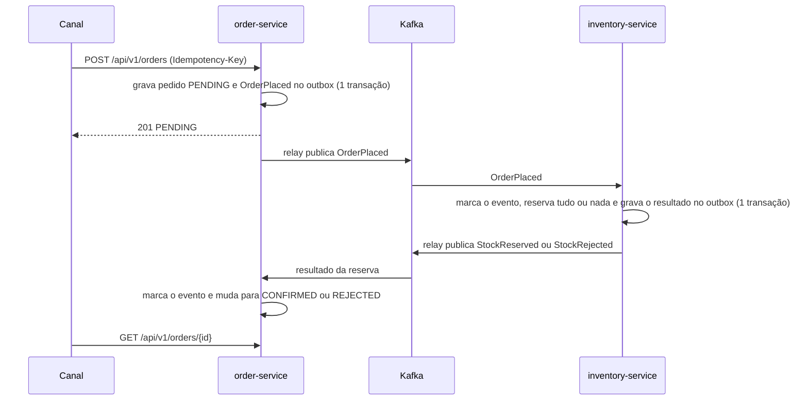

# Arquitetura

## Objetivos

O sistema deve confirmar pedidos sem perder rastreabilidade quando um serviço fica indisponível, uma mensagem é entregue mais de uma vez ou o processo é interrompido. A arquitetura prioriza consistência observável, recuperação e simplicidade operacional.

## Limites de domínio

- **Order (`order-service`):** recebe a intenção de compra, valida a requisição e controla o estado do pedido.
- **Inventory (`inventory-service`):** mantém a disponibilidade e registra reservas de estoque.
- **Notification (planejado):** reagirá a eventos confirmados e registrará a entrega de notificações simuladas.

Cada contexto tem dados próprios. A comunicação entre eles acontece por eventos versionados no Kafka; não há chamadas síncronas entre serviços.

## Implementação atual

Fluxo de um pedido:

Organização de cada serviço:

- `domain`: entidades JPA e regras (por exemplo, `Order`, `Money`, `Product`), sem dependência das camadas externas;
- `application`: casos de uso e transações;
- `web` e `messaging`: adaptadores HTTP e Kafka, que só chamam a camada `application`.

Testes ArchUnit verificam essas dependências em cada serviço. Os contextos compartilham apenas o módulo `event-contracts`; a infraestrutura comum (erros, segurança, OpenAPI, outbox, deduplicação e política de retry) fica em `service-support`.

## Decisões de consistência

- O pedido é persistido na mesma transação que registra o evento no outbox, e um relay o publica depois ([ADR 0007](adr/0007-transactional-outbox.md)).
- Consumidores registram o id do evento antes de aplicar os efeitos, na mesma transação; entregas repetidas não têm efeito ([ADR 0008](adr/0008-eventos-versionados-e-consumidores-idempotentes.md)).
- A reserva de estoque bloqueia as linhas em ordem fixa, e o banco garante o invariante com `CHECK` ([ADR 0004](adr/0004-reserva-de-estoque-concorrente.md)).
- Retentativas são limitadas, espaçadas exponencialmente e preservam a ordem por pedido; o que não se recupera vai para `<tópico>.DLT` com o motivo nos cabeçalhos.
- Eventos fora de ordem não corrompem o estado: um `OrderPlaced` posterior ao cancelamento não reserva estoque, e um resultado tardio não altera um pedido cancelado.
- A criação de pedidos é idempotente por cliente e chave ([ADR 0005](adr/0005-idempotencia-na-criacao-de-pedidos.md)).
- O status final é derivado de eventos persistidos, não da ausência de erro no cliente.

## Evolução

A ADR 0001 previa começar com um monólito modular e extrair o estoque depois; o histórico de commits mostra cada passo:

1. **Fase 1:** monólito modular, com um schema por módulo e reserva síncrona na mesma transação ([ADR 0003](adr/0003-monolito-modular-com-schema-por-modulo.md)).
2. **Fase 2:** API protegida como resource server OAuth 2.0 com escopos ([ADR 0006](adr/0006-seguranca-oauth2-resource-server.md)), testes de arquitetura e CI.
3. **Fase 3:** outbox e Kafka ainda dentro do monólito, reserva por eventos com consumidores idempotentes, retry com DLT e, por fim, a extração do estoque para um serviço com banco próprio ([ADR 0009](adr/0009-extracao-do-servico-de-estoque.md)).

## Implantação

O ambiente local usa Docker Compose (dois PostgreSQL e um Kafka em modo KRaft); os serviços rodam como JARs na máquina do desenvolvedor. Estão planejados o empacotamento em containers, o ambiente de demonstração em Kubernetes (validado primeiro com `kind`) e a implantação opcional na AWS com Terraform, com documentação de custos e procedimento de destruição dos recursos.

Nenhum recurso pago é criado pelo CI.

## Segurança

Implementado: OAuth 2.0 com tokens JWT validados por assinatura, emissor, audiência e validade; autorização por escopo; validação de entrada com Bean Validation; segredos apenas no `.env` local, ignorado pelo Git; respostas de erro sem detalhes internos. Planejado: imagens de container com usuário sem privilégios e um provedor de identidade gerenciado no ambiente de demonstração. Logs não armazenam tokens nem dados pessoais.
